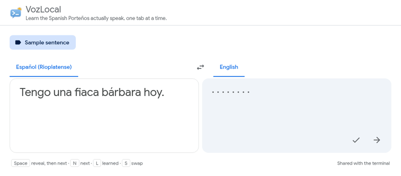
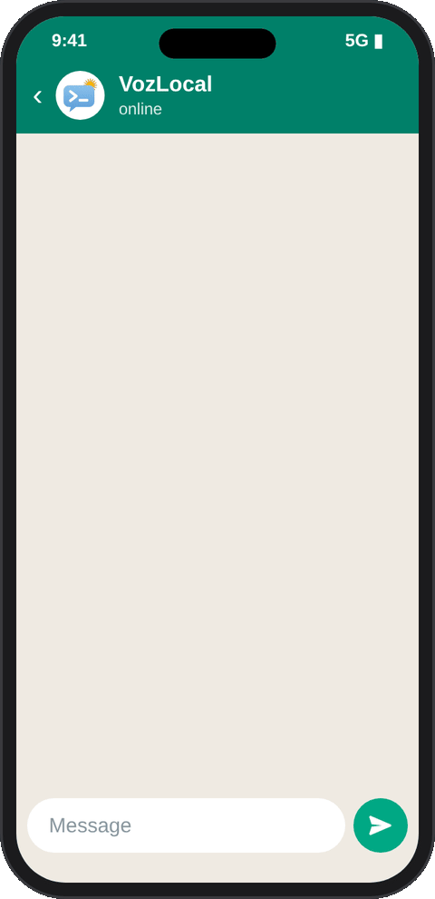
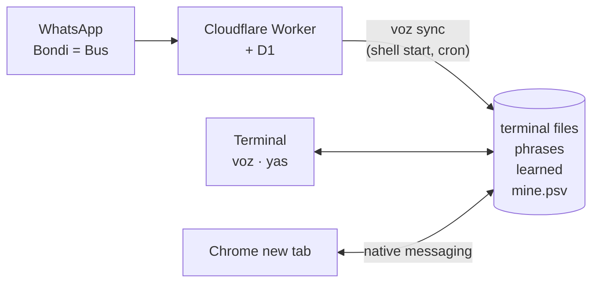

<p align="center">
  
</p>

<h1 align="center">VozLocal</h1>

<p align="center">
  <strong>Learn the Spanish Porteños actually speak, one terminal at a time.</strong><br />
  🇦🇷 Rioplatense Spanish, straight from the streets of Buenos Aires
</p>

<p align="center">
  
  
  
  <a href="https://github.com/lawrence-berry/VozLocal/actions/workflows/test.yml"></a>
  
</p>

<p align="center">
  
</p>

Textbook Spanish won't help when someone in Buenos Aires says *"Che, ¿vos querés ir al bondi o caminamos?"* VozLocal teaches the slang (*lunfardo*), the *vos* verb forms and the everyday expressions by repetition, in the places you already spend your day. A phrase appears, you get a moment to recall its meaning, and then the translation is revealed. There's no app to open, no streak to keep, and nothing leaves your machine unless you set up the bot.

It ships with 37 phrases in five categories (greetings, *voseo*, expressions, *lunfardo* and full sentences), and you can add your own.

## Four parts, one set of phrases

| Part | What it does | Built with |
|---|---|---|
| [**Terminal**](terminal/README.md) | A phrase when you open a terminal, with `voz` for another and `yas` to mark one as learned | zsh |
| [**Chrome new tab**](chrome/README.md) | The same phrases in every new tab, laid out like Google Translate | Manifest V3 extension, native messaging |
| [**Android screensaver**](android/README.md) | The phrases as the phone's screensaver, with a countdown and a slowly drifting, dimming display | Kotlin `DreamService`, WebView |
| [**WhatsApp bot**](bot/README.md) | Text `Bondi = Bus` to your bot, reply `yes`, and the phrase joins your rotation | Cloudflare Worker, D1, WhatsApp Cloud API |

<p align="center">
  
</p>

<p align="center">
  
</p>



The terminal's files are the single source of truth. Mark a phrase as learned in either place and it stops appearing in both. Phrases from WhatsApp sync when a terminal opens, with a macOS notification when new ones arrive. With the optional cron job (`voz install-cron`), they arrive within two minutes even with no terminal open.

## Quick start

```sh
git clone https://github.com/lawrence-berry/VozLocal.git ~/VozLocal
echo 'source ~/VozLocal/terminal/vozlocal.plugin.zsh' >> ~/.zshrc
```

Open a new terminal. To add the Chrome extension, see [chrome/README.md](chrome/README.md). The bot is optional and self-hosted; see [bot/README.md](bot/README.md).

## Engineering highlights

- **A browser talking to local files.** Chrome extensions can't read files, so a small zsh program speaks Chrome's native messaging protocol. It shares a file lock with the terminal.
- **Careful with untrusted input.** The plugin runs inside your shell, so your options and aliases can't change it, and settings are checked as plain numbers so a bad value can't run code. The bot verifies Meta's HMAC signature over the raw request bytes, answers only allowed numbers, handles each message once despite retries, and refuses phrases with hidden or control characters.
- **Resilient sync.**
  - Marks made while Chrome can't reach the terminal are queued and replayed.
  - A new tab never waits more than 0.4 s for the terminal.
  - An optional cron job keeps phrases flowing when no terminal is open.

## Tests

All four run on every push and pull request, in GitHub Actions, and the terminal suite runs on both macOS and Linux.

| Part | Command | Checks |
|---|---|---|
| Terminal | `zsh terminal/tests/run.zsh` | 98, in plain zsh, including real pseudo-terminal shells |
| Bot | `cd bot && node --test` | 19, against Node's built-in SQLite with the real migration (Node 22.13 or newer) |
| Chrome logic | `cd chrome && node --test` | 19, on picking phrases and reading the terminal's replies |
| Android screensaver logic | `cd android && node --test` | 4, on reading the phrases, drift, dimming and the offline cache |
| Chrome in the browser | `chrome/bin/dev bundle exec rspec` | 40 RSpec specs, most of them Playwright specs that load the real extension and its native host in Chromium, in Docker |

## Roadmap

- **Speech mode?**
- **Android screensaver (Motorola).** Show the phrases as the phone's screensaver over a custom background image. A high-level plan, in order:
  1. **Phrases to the phone.** The phone can't read the Mac's files, so the bot's D1 database becomes the phone's source: add a read-only, token-protected `/phrases` endpoint to the Worker, and have the terminal's `voz sync` push learned marks back so all four places stay in step.
  2. **Backgrounds from DeviantArt.** The existing Ruby DeviantArt code runs on the Mac (cron, in Docker) and uploads a few chosen images plus a small `backgrounds.json` to a Cloudflare R2 bucket through the Worker. The phone only downloads; it never scrapes. Check each artist's terms before reusing their art, and keep the credit text with the image.
  3. **The screensaver itself (built).** See [android/README.md](android/README.md). A `DreamService` hosts one `WebView` on a page bundled in the APK, reusing the Chrome new tab's logic and font. The app fetches `/phrases` itself, so the token never reaches the page. The background is a bundled placeholder until step 2 lands.
  4. **Offline and battery (phrases built).** The last phrases are cached on the phone, refreshed each time the screensaver starts, and the text drifts and dims slowly to avoid OLED burn-in. Still to do: caching the backgrounds.
  5. **Install.** Side-load the APK for personal use first; the Play Store is a later question.
- **Duolingo screenshots to phrases.** Screenshot the words you're struggling with in Duolingo, send the image to the bot, and get the Spanish and English pairs back. A high-level plan, in order:
  1. **Send the image to the bot.** Duolingo is on the phone and so is WhatsApp, so the screenshot goes to the existing bot as an image message. The Worker fetches the image from the WhatsApp Cloud API's media endpoint, still answering only allowed numbers.
  2. **Extract with a vision model.** The Worker sends the image to Claude (Haiku, which can read images and is cheap) with a prompt asking for a JSON list of `{spanish, english}` pairs and nothing else. The Anthropic key is a Worker secret.
  3. **Reuse the confirm flow.** The bot replies with the pairs, you answer `yes`, and they join the rotation exactly like a typed `Bondi = Bus` does today. Nothing is saved unconfirmed, and the existing check that refuses hidden or control characters runs on every extracted phrase, because the model's output is untrusted.
  4. **Later, if wanted.** Drop screenshots from the Mac too (a `voz add-image` command), and tag these phrases as "Duolingo" so they can be filtered.

## Licence

[MIT](LICENSE).

<p align="center">
  <br />
  <em>¡Dale, a practicar!</em> 🇦🇷
</p>
