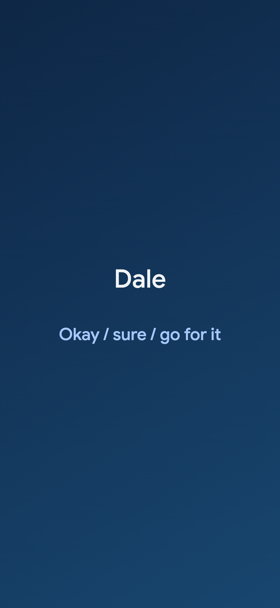

<p align="center"></p>

# VozLocal screensaver for Android

The phrases as the phone's screensaver (Settings › Display › Screen saver): a Rioplatense Spanish phrase, a countdown of dots, then its meaning, over a background image. The text drifts to a new spot every few minutes and dims over half an hour, to spare an OLED screen.

<p align="center"></p>

## How it works

- `VozDream.kt` is a `DreamService` with one `WebView`. The `WebView` loads `app/src/main/assets/index.html` through `WebViewAssetLoader`, which gives the bundled page a real https origin so its ES modules and `localStorage` work.
- `screensaver.js` picks phrases with the Chrome new tab's own logic (`voz.js`) from the built-in phrases and the personal ones from the WhatsApp bot. `lib.js` holds the parts that need no browser (parsing, drift, dimming, the cache) and is what `node --test` checks.
- The app, not the page, calls the Worker's `GET /phrases` with the bearer token, then hands the text to `window.vozPersonal`. The Worker sends no CORS headers, and the token never reaches the page. The last phrases are cached in `localStorage`, so the screensaver works offline. A failed fetch keeps the cache.
- `voz.js`, `phrases.json` and the font are bundled straight from `chrome/extension` by `app/build.gradle.kts`, so the Chrome tab stays the single source.

## Configure

Create the gitignored `android/local.properties`:

```properties
VOZ_URL=https://<the worker's address>
VOZ_TOKEN=<the Worker's SYNC_TOKEN>
```

Without it, the screensaver shows the built-in phrases only. The token is built into the APK, so keep the APK to personal use. The app refuses to send it over anything but https.

## Build and install

The Android SDK lives in Docker, not on the Mac:

```sh
android/bin/build        # android/app/build/outputs/apk/debug/app-debug.apk
adb install -r android/app/build/outputs/apk/debug/app-debug.apk
```

The first build downloads the SDK and Gradle's dependencies, and runs under emulation on Apple silicon, so it is slow. Then choose **VozLocal** under Settings › Display › Screen saver.

## Tests

```sh
cd android && node --test
```

## Not built yet

- Backgrounds from DeviantArt (the bundled `background.svg` is a placeholder).
- Learned marks on the phone: every phrase can still come up.
